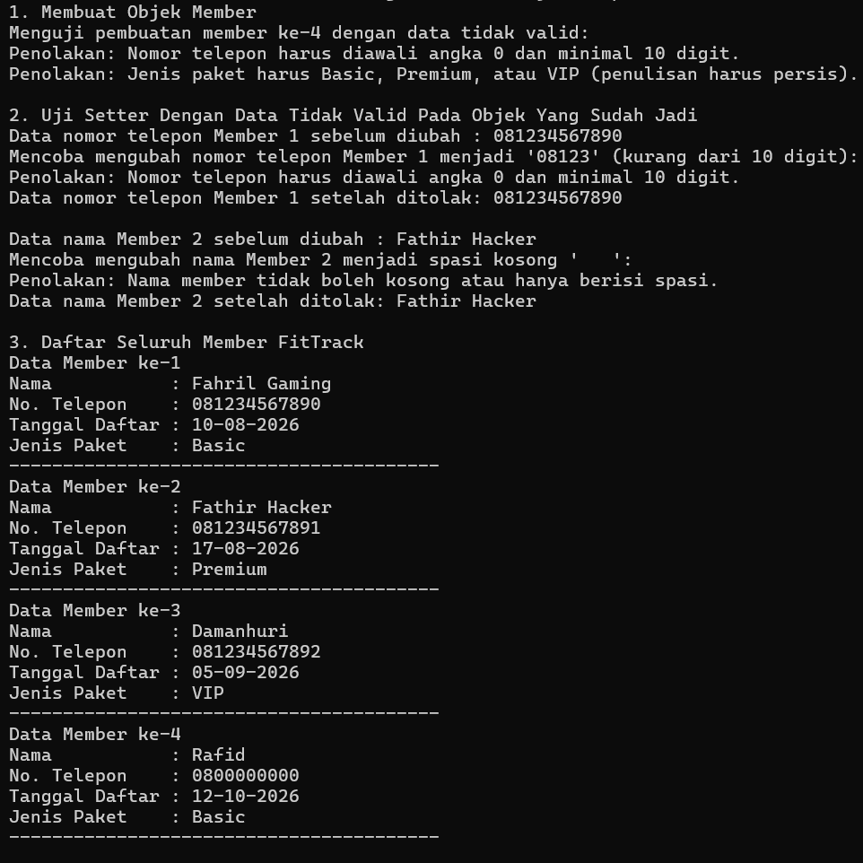

# Tugas 1 & Remedial UTS Praktikum PBO: Sistem Keanggotaan Gym FitTrack


## Identitas

* **Nama Tugas:** Remedial UTS Praktikum PBO / Tugas 1: Sistem Keanggotaan Gym FitTrack
* **Nama Lengkap:** Rafid Khaulika
* **NPM:** 250810701100016
* **Kelas Praktikum:** Praktikum Pemrograman Berorientasi Objek Kelas A

## Deskripsi Singkat

FitTrack adalah gym lokal dengan member aktif sekitar 150 member yang sebelumnya masih mencatat data keanggotaan secara manual di buku tulis sehingga rawan terjadinya data yang tercecer, sulit dibaca, dan lambat dicari saat jam operasional sibuk. Program berbasis Java ini dibuat sebagai langkah awal digitalisasi untuk mencatat data member di komputer resepsionis selama aplikasi berjalan. Fokus utama program ini adalah memvalidasi setiap data yang masuk, seperti nama, nomor telepon, tanggal daftar, dan jenis paket, dengan tujuan agar tidak ada kesalahan input yang membuat staf gagal menghubungi member.

## Fitur Utama

* **Pendaftaran Member Lengkap:** Staf resepsionis dapat mendaftarkan member baru dengan mengisi nama lengkap, nomor telepon, tanggal pendaftaran, dan memilih paket keanggotaan (berupa paket `Basic`, `Premium`, atau `VIP`).
* **Pendaftaran Cepat Tanpa Pilih Paket:** Staf dapat mendaftarkan member baru hanya dengan memasukkan nama, nomor telepon, dan tanggal daftar, di mana sistem otomatis mengatur paket keanggotaan ke `Basic`.
* **Pemeriksaan Format Data Otomatis:** Sistem secara otomatis menolak nama atau tanggal yang kosong/hanya berisi spasi, nomor telepon yang tidak diawali angka `0` atau kurang dari 10 digit, serta pilihan paket di luar `Basic`, `Premium`, dan `VIP`.
* **Perlindungan Data Member dari Perubahan Salah:** Apabila staf salah memasukkan data baru saat mengubah data member yang sudah terdaftar, sistem menampilkan pesan alasan penolakan yang jelas dan mempertahankan data lama yang sudah benar.
* **Pemberian Nilai Default yang Aman:** Kalau ada data yang salah ketik saat pertama kali mendaftarkan member baru, program tidak berhenti paksa melainkan tetap membuat data member dengan nilai cadangan (default) yang aman.
* **Tampilan Daftar Seluruh Member:** Staf dapat melihat seluruh daftar member yang tersimpan secara berurutan dengan tampilan berlabel yang rapi dan mudah dibaca.

## Konsep OOP yang Diterapkan

| Nama Konsep | Lokasi Penerapan (Class / Method) | Alasan Pemilihan Konsep |
| :--- | :--- | :--- |
| **Class dan Object** | Class `Member` dan pembuatan objek di `TesFitTrack.main()` | Mengelompokkan data seorang member (nama, nomor telepon, tanggal daftar, jenis paket) beserta perilakunya ke dalam satu kesatuan objek yang rapi. |
| **Encapsulation (Enkapsulasi)** | Atribut `private` (`nama`, `noTelepon`, `tanggalDaftar`, `jenisPaket`) serta method `public` getter dan setter di class `Member` | Melindungi atribut agar tidak bisa diubah sembarangan dari luar class tanpa melewati aturan validasi di dalam setter. |
| **Constructor Overloading & `this(...)`** | `Member(nama, noTelepon, tanggalDaftar, jenisPaket)` dan `Member(nama, noTelepon, tanggalDaftar)` | Memberikan fleksibilitas pembuatan objek (dengan atau tanpa input paket) serta menghindari duplikasi kode dengan meneruskan pemanggilan ke constructor utama memakai `this(...)`. |
| **Prinsip DRY (Don't Repeat Yourself) pada Validasi** | Pemanggilan `setNama()`, `setNoTelepon()`, `setTanggalDaftar()`, dan `setJenisPaket()` di dalam constructor `Member` | Memusatkan logika pemeriksaan data hanya di setter sehingga tidak perlu menulis ulang `if-else` yang sama di dalam constructor. |
| **Method Overriding (`toString()`)** | Method `public String toString()` pada class `Member` | Menggantikan representasi alamat memori bawaan Java menjadi teks berlabel yang rapi saat objek dicetak dengan `System.out.println()`. |

## Struktur Project

```text
tugas1-fittrack/
├── src/
│   ├── Member.java
│   └── TesFitTrack.java
├── .gitignore
└── README.md
```

## Prasyarat
* **Versi JDK:** Java Development Kit (JDK) 21 dengan versi JDK 21.0.12.1.
* **IDE yang Disarankan:** Visual Studio Code dengan Extension Pack for Java, program juga dapat dikompilasi dan dijalankan langsung lewat Terminal / Command Prompt.

## Cara Menjalankan Program
### 1. Melalui Command Line (Terminal / Command Prompt)
1. Buka Terminal atau Command Prompt, lalu masuk ke folder project:
   ```bash
   cd tugas1-fittrack
   ```
2. Kompilasi seluruh file Java yang ada di dalam folder `src`:
   ```bash
   javac -d out src/Member.java src/TesFitTrack.java
   ```
3. Jalankan class utama `TesFitTrack` dengan menentukan classpath ke folder `out`:
   ```bash
   java -cp out TesFitTrack
   ```

### 2. Melalui Visual Studio Code
1. Pasang **Extension Pack for Java** di Visual Studio Code.
2. Buka folder `tugas1-fittrack` lewat **File > Open Folder**.
3. Buka file `src/TesFitTrack.java`, lalu klik tulisan **Run** yang muncul di atas baris `public static void main`.
4. Lihat hasil keluaran program pada panel **Terminal** di bagian bawah layar.

## Contoh Output
Berikut adalah hasil eksekusi program ketika dijalankan (mencakup pembuatan objek normal, penolakan data tidak valid pada constructor dan setter, serta pencetakan seluruh isi array):

```text
1. Membuat Objek Member
Menguji pembuatan member ke-4 dengan data tidak valid:
Penolakan: Nomor telepon harus diawali angka 0 dan minimal 10 digit.
Penolakan: Jenis paket harus Basic, Premium, atau VIP (penulisan harus persis).

2. Ui Setter Dengan Data Tidak Valid Pada Objek Yang Sudah Jadi
Data nomor telepon Member 1 sebelum diubah : 081234567890
Mencoba mengubah nomor telepon Member 1 menjadi '08123' (kurang dari 10 digit):
Penolakan: Nomor telepon harus diawali angka 0 dan minimal 10 digit.
Data nomor telepon Member 1 setelah ditolak: 081234567890

Data nama Member 2 sebelum diubah : fathir hacker
Mencoba mengubah nama Member 2 menjadi spasi kosong '   ':
Penolakan: Nama member tidak boleh kosong atau hanya berisi spasi.
Data nama Member 2 setelah ditolak: fathir hacker

3. Daftar Seluruh Member FitTrack
Data Member ke-1
Nama           : fahril gaming
No. Telepon    : 081234567890
Tanggal Daftar : 10-08-2026
Jenis Paket    : Basic
----------------------------------------
Data Member ke-2
Nama           : fathir hacker
No. Telepon    : 081234567891
Tanggal Daftar : 17-08-2026
Jenis Paket    : Premium
----------------------------------------
Data Member ke-3
Nama           : damanhuri
No. Telepon    : 081234567892
Tanggal Daftar : 05-09-2026
Jenis Paket    : VIP
----------------------------------------
Data Member ke-4
Nama           : rafid
No. Telepon    : 0800000000
Tanggal Daftar : 12-10-2026
Jenis Paket    : Basic
----------------------------------------
```

Berikut tangkapan layar hasil eksekusi program di komputer:



## Nilai Default Saat Data Tidak Valid
Sesuai ketentuan desain, apabila terdapat input yang melanggar aturan validasi ketika objek pertama kali dibuat lewat constructor, objek `Member` tetap terbentuk menggunakan nilai default yang aman:
* **`nama` -> `"Member Baru"`**: Dipilih karena tidak kosong dan langsung memberi tanda kepada staf resepsionis bahwa nama asli member tersebut belum berhasil diinput dengan benar dan perlu diperbarui.
* **`noTelepon` -> `"0800000000"`**: Dipilih karena memenuhi aturan panjang minimal 10 digit dan diawali angka `0`, namun deretan angka nol di belakangnya menjadi penanda jelas bagi staf bahwa nomor telepon asli member belum tercatat.
* **`tanggalDaftar` -> `"16-10-2026"`**: Menggunakan format konsisten `dd-MM-yyyy` supaya atribut tanggal tidak bernilai `null` atau kosong jika staf lupa mengisi tanggal pendaftaran.
* **`jenisPaket` -> `"Basic"`**: Sesuai dengan ketentuan soal, paket `Basic` merupakan tingkat keanggotaan dasar paling aman apabila input paket tidak dikenali atau di luar tiga pilihan yang tersedia.

## Batasan dan Pengembangan Lanjutan
* **Batasan Saat Ini:**
  * Data member masih disimpan di dalam array berukuran tetap di memori (RAM), sehingga data akan hilang ketika program ditutup dan jumlah maksimal member belum fleksibel.
  * Pemeriksaan nomor telepon baru sebatas memeriksa awalan `0` dan panjang minimal 10 karakter, belum memeriksa apakah seluruh karakter murni berisi angka.
  * Belum ada menu interaktif berbasis input pengguna (`Scanner`) karena pengujian masih dijalankan langsung lewat skenario di `main`.
* **Pengembangan Lanjutan:**
  * Menambahkan fitur input interaktif menggunakan `Scanner` agar staf resepsionis dapat menambah, mencari, dan mengubah data member melalui menu pilihan.
  * Menyimpan data ke dalam file teks/CSV atau database supaya data member tetap tersimpan permanen meskipun komputer dimatikan.
  * Memperketat validasi format tanggal pendaftaran dan memastikan nomor telepon hanya berisi karakter angka `0-9`.
